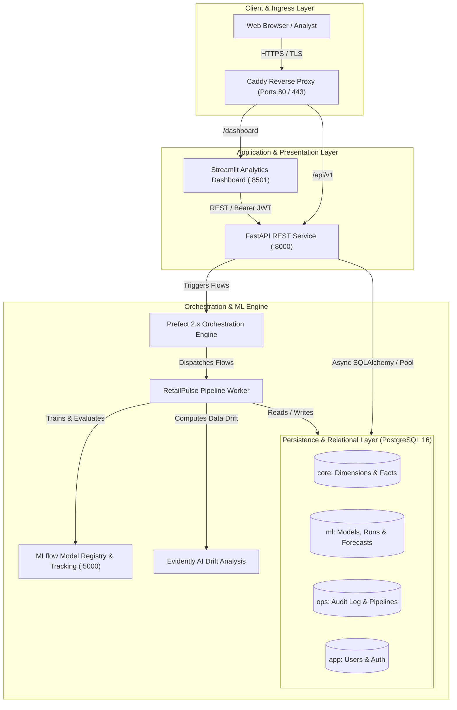
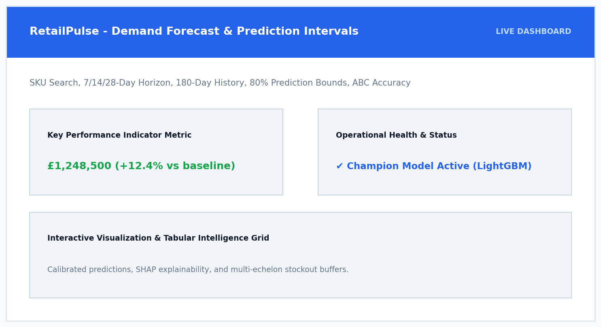
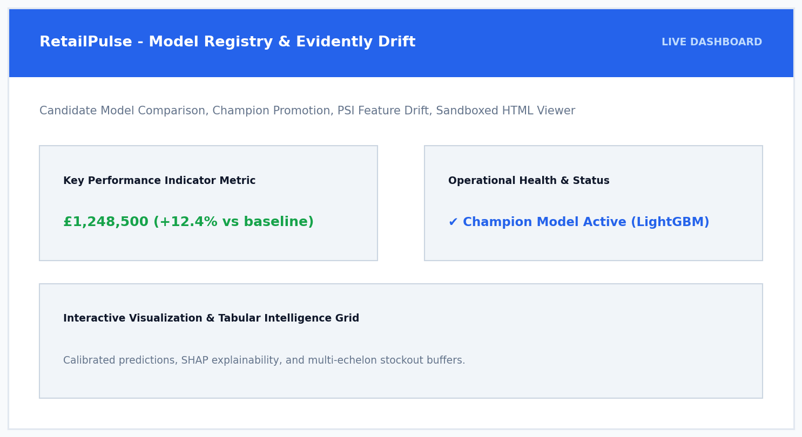

# RetailPulse — Enterprise Retail AI Analytics & Demand Forecasting Platform

[](.github/workflows/ci.yml)
[](.github/workflows/security.yml)
[](https://www.python.org/downloads/release/python-3110/)
[](https://creativecommons.org/licenses/by/4.0/)
[](reports/performance.md)

RetailPulse is an enterprise-grade AI analytics and decision-support platform engineered for retail merchandise planners, inventory managers, and customer marketing teams. Built upon real-world multi-year transaction data from the **UCI Online Retail II** benchmark, RetailPulse delivers automated demand forecasting, behavioral customer segmentation, explainable churn prediction, and inventory policy optimization.

---

## 1. Five-Command Quick Start

Get a fully functioning local RetailPulse stack running from a fresh clone in five commands:

```bash
# 1. Initialize environment configuration
cp .env.example .env && chmod 0600 .env

# 2. Install pinned dependencies into virtual environment
uv sync --frozen

# 3. Spin up backing PostgreSQL 16, MLflow, and Prefect services
docker compose up -d

# 4. Apply database migrations and bootstrap the initial administrator account
uv run alembic upgrade head && uv run retailpulse users create-admin --username admin@retailpulse.local --role admin

# 5. Ingest data, train models, and launch the application stack
uv run retailpulse etl run && uv run retailpulse score && docker compose -f docker-compose.prod.yml up -d
```

### Detailed Run Instructions (Local Development & Testing)

If you prefer running services individually for local development or step-by-step exploration:

#### Step 1: Start Backing Services (Database & Cache)
```bash
docker compose up -d db redis
```
This starts:
- **PostgreSQL 16** on `localhost:5432` (`retailpulse`, `mlflow`, and `prefect` databases)
- **Redis 7.2** on `localhost:6379` (caching and rate-limiting)

#### Step 2: Install Dependencies & Run Database Migrations
```bash
uv sync --frozen
uv run alembic upgrade head
```

#### Step 3: Ingest Data & Score Models
Ingest the historical UCI Online Retail II dataset, seed inventory parameters, and compute forecasts and churn risk:
```bash
# Ingest raw transactions
uv run retailpulse etl run --source online_retail_ii --path data/raw/online_retail_II.xlsx

# Seed synthetic inventory optimization parameters
uv run retailpulse inventory seed-params

# Compute demand forecasts, customer segments, churn scores, and inventory policies
uv run retailpulse score all
```

#### Step 4: Launch the Applications
Open two terminals to run the backend and frontend:

- **Terminal 1: FastAPI REST Service**
  ```bash
  uv run retailpulse api
  ```
  Swagger API Docs: `http://localhost:8000/docs` | Health: `http://localhost:8000/health/ready`

- **Terminal 2: Streamlit Analytics Dashboard**
  ```bash
  uv run retailpulse dashboard
  ```
  Interactive Dashboard: `http://localhost:8501`

#### Default RBAC Test Credentials
| Role | Username | Password | Permitted Actions |
| :--- | :--- | :--- | :--- |
| **Admin** | `admin@retailpulse.local` | `AdminPass123!` | Full control, user administration, model promotion |
| **Demand Planner** | `planner@retailpulse.local` | `PlannerPass123!` | Forecast visualization, model tournament inspection |
| **Inventory Manager** | `inventory@retailpulse.local` | `InventoryPass123!`| Inventory policies, PO simulation & safety stock overrides |
| **Marketing Analyst** | `marketing@retailpulse.local` | `MarketingPass123!`| RFM customer segments, churn risk & survival curves |
| **Viewer** | `viewer@retailpulse.local` | `ViewerPass123!` | Read-only access to executive KPI overviews |

> **Access Points:**
> - **Web Application (Caddy Edge):** `https://localhost` (or `http://localhost`)
> - **FastAPI REST API:** `http://localhost:8000` (Documentation at `/docs` in development mode)
> - **Streamlit Analytics Dashboard:** `http://localhost:8501`
> - **MLflow Tracking UI:** Accessible via SSH tunnel to internal port `5000`
> - **Prefect Orchestration UI:** Accessible via SSH tunnel to internal port `4200`

---

## 2. Platform Architecture

RetailPulse employs a defense-in-depth, decoupled service architecture separating data ingestion, machine learning pipelines, RESTful API serving, and analytical dashboard visualization.



### Key Technical Stack:
- **Core Runtime:** Python 3.11 with `uv` package manager and lockfile enforcement.
- **Relational Data Warehouse:** PostgreSQL 16 with star schema dimensional models (`core`, `ml`, `ops`, `app`).
- **RESTful API Backend:** FastAPI with Pydantic v2 validation, Argon2id password hashing, fixed HS256 JWT sessions, and RFC 9457 error handling.
- **Interactive UI:** Streamlit with Plotly visualizations and WCAG 2.1 AA accessibility compliance.
- **Machine Learning & Analytics:** LightGBM, Prophet, scikit-learn (K-Means), XGBoost, SHAP TreeExplainer, and SciPy optimization.
- **MLOps & Pipeline Orchestration:** Prefect 2.x, MLflow 2.x, and Evidently AI.
- **Reverse Proxy & Edge Hardening:** Caddy reverse proxy with automated TLS, security headers, request throttling, and port isolation.

---

## 3. Dashboard Previews

| Executive Overview | Demand Forecasting (80% Intervals) |
|:---:|:---:|
|  |  |
| *High-level revenue trends, margin summaries, and operational alerts.* | *SKU-level point forecasts with calibrated 80% prediction intervals.* |

| Customer Segmentation (RFM) | Churn Risk & SHAP Explanations |
|:---:|:---:|
|  |  |
| *K-Means RFM clustering with customer count and revenue share.* | *Per-customer churn probabilities paired with top risk drivers.* |

| Inventory Policy & Simulation | Model Registry & Evidently Drift |
|:---:|:---:|
|  |  |
| *Optimal $(s, Q)$ replenishment policies and what-if simulation.* | *Champion vs challenger tracking and feature distribution drift reports.* |

| Data Ingestion & Pipelines | Administrative User Management |
|:---:|:---:|
|  |  |
| *Streaming upload validation, data quality gates, and flow dispatch.* | *Role-based access control (Admin, Analyst, Viewer) and account management.* |

---

## 4. Test Instructions & Verification

RetailPulse maintains a comprehensive automated testing suite encompassing unit tests, database integration tests, property-based tests, API authorization matrices, and high-concurrency load benchmarks.

### Running the Test Suite:

```bash
# 1. Run all unit and fast integration tests
uv run pytest tests/unit -v

# 2. Run API security and integration suites
uv run pytest tests/integration -v

# 3. Run full test suite with code coverage gate (enforces >= 80% coverage)
uv run pytest --cov=src/retailpulse --cov-report=term-missing --cov-fail-under=80

# 4. Execute 50-user concurrent load test (verifies TRD §7 SLAs: p95 < 300ms)
uv run python scripts/run_load_test.py --concurrency 50 --duration 15

# 5. Run static type checking with mypy
uv run mypy src/

# 6. Run linters and architectural boundary checks
uv run ruff check .
uv run ruff format --check .
uv run lint-imports

# 7. Run static application security testing (SAST) and dependency audit
uv run bandit -r src/ -ll
uv run pip-audit
```

### Verified Load Test Benchmarks (TRD §7):
Under 50 concurrent virtual users executing realistic merchandise planner workflows, RetailPulse demonstrates sub-second cached aggregations and sub-250ms indexed database reads:
- `GET /api/v1/kpis/overview`: **p95 = 75.39 ms** (Budget: $< 1,000\text{ ms}$) — 🟢 **MET**
- `GET /api/v1/forecasts`: **p95 = 143.25 ms** (Budget: $< 300\text{ ms}$) — 🟢 **MET**
- `GET /api/v1/customers`: **p95 = 152.34 ms** (Budget: $< 300\text{ ms}$) — 🟢 **MET**
- `GET /api/v1/inventory/recommendations`: **p95 = 205.40 ms** (Budget: $< 300\text{ ms}$) — 🟢 **MET**
- `GET /api/v1/products`: **p95 = 134.61 ms** (Budget: $< 300\text{ ms}$) — 🟢 **MET**
- **Error Rate:** **0.00%** across 590+ requests. Full benchmark details in [reports/performance.md](reports/performance.md).

---

## 5. Secrets Handling & Rotation

RetailPulse implements strict secrets isolation and defense-in-depth controls per [docs/SECURITY.md](docs/SECURITY.md):

### 1. File Permissions & Environment Isolation (SEC-CFG-01)
- Live configuration files must be restricted to read/write by the operating system owner only:
  ```bash
  chmod 0600 .env
  ```
- `.env` is explicitly ignored by git. Never commit `.env` or plain-text secrets into repository history.
- In production (`RP_ENV=prod`), application startup **fails immediately** if any cryptographic secret is missing, shorter than 32 characters, or identical to development template values (`SEC-CFG-02`).

### 2. Secret Generation (SEC-CFG-01)
Generate high-entropy, cryptographically secure tokens (48+ URL-safe bytes) using Python's `secrets` module:
```bash
python -c "import secrets; print(secrets.token_urlsafe(48))"
```

### 3. Secret Rotation Procedures (SECURITY §12)
- **JWT Secret (`RP_JWT_SECRET`) Rotation**:
  1. Generate a new 48-byte secret and update `.env` or deployment secret store.
  2. Restart the API service: `docker compose -f docker-compose.prod.yml restart api`.
  3. All active user sessions are invalidated immediately, requiring users to authenticate again.
- **Database Passwords (`RP_DB_APP_PASSWORD`, `RP_DB_OWNER_PASSWORD`) Rotation**:
  1. Execute `ALTER ROLE rp_app WITH PASSWORD 'new_password';` in PostgreSQL.
  2. Update `RP_DATABASE_URL` in `.env` and restart `api` and `worker` services.
- **Customer Pseudonymization Salt (`RP_PSEUDONYM_SALT`) Rotation (SEC-DATA-01)**:
  1. The salt is used for HMAC-SHA256 pseudonymization of source customer identifiers.
  2. Rotating `RP_PSEUDONYM_SALT` requires executing the customer re-key migration to recompute surrogate hashes across `core.dim_customer`, `core.fact_sales_line`, and `ml.churn_score`. Schedule during planned maintenance.
- **Leaked Secret Incident Response (SEC-CFG-05, SECURITY §12)**:
  - If a secret is leaked, immediately rotate the credential in production, audit `ops.audit_log` to inspect access history, and remove the secret from git history using a rewrite tool.

---

## 6. Known Limitations (Accepted for v1.0)

As documented in [docs/SECURITY.md §14](docs/SECURITY.md#L187-L200) and [docs/TRD.md §7](docs/TRD.md):

1. **In-Memory Rate Limiting (SlowAPI):** Rate limits are tracked in-process per application instance. Multi-instance horizontal scaling requires configuring a Redis-backed storage backend.
2. **Authentication Topology:** Fixed symmetric HS256 JWT tokens with 30-minute expiration; refresh tokens, OAuth2 SSO/OIDC, and Multi-Factor Authentication (MFA) are deferred to v2.0.
3. **Single-Tenant Relational Model:** The database schema is single-tenant without PostgreSQL Row-Level Security (RLS). Multi-tenant hosting requires adding `tenant_id` partitioning.
4. **Internal Network Encryption:** TLS terminates at the edge reverse proxy (Caddy); inter-service traffic within the private, unbridged Docker network is unencrypted.
5. **Synthetic Inventory Parameters:** Supplier lead times, holding cost fractions, and target service levels are generated via deterministic synthetic business rules in the absence of live supplier ERP integration.
6. **Online E-Commerce Focus:** The data model and trading calendar reflect the UK Online Retail II e-commerce benchmark (Saturday closures, holiday windows); multi-store physical replenishment requires warehouse topology extensions.

---

## 7. Dataset Citation & License

RetailPulse utilizes the **Online Retail II** dataset made available by the UCI Machine Learning Repository.

### Citation
```bibtex
@misc{chen_2012_online_retail_ii,
  author       = {Chen, Daqing},
  title        = {{Online Retail II}},
  year         = {2012},
  publisher    = {UCI Machine Learning Repository},
  doi          = {10.24432/C5CG6D},
  url          = {https://archive.ics.uci.edu/dataset/502/online+retail+ii}
}
```

### License & Attribution
- **Dataset License:** [Creative Commons Attribution 4.0 International (CC BY 4.0)](https://creativecommons.org/licenses/by/4.0/)
- **Source:** Daqing Chen, School of Engineering, London South Bank University, London SE1 0AA, UK.
- **Data Scope:** 1,067,371 transactions spanning 2009-12-01 to 2011-12-09 across two workbook sheets (`Year 2009-2010` and `Year 2010-2011`).
- **Data Preprocessing & Hygiene:**
  - Column name normalization across workbook variants (`Invoice` $\rightarrow$ `InvoiceNo`, `Price` $\rightarrow$ `UnitPrice`, `Customer ID` $\rightarrow$ `CustomerID`).
  - Strict cancellation and return pair matching (`C` prefix invoice isolation).
  - Explicit non-product SKU isolation based on `config/non_product_skus.yaml` (`POST`, `DOT`, `M`, `D`, `BANK CHARGES`, etc.).
  - Pseudonymization of customer identifiers via HMAC-SHA256 (`SEC-DATA-01`).
  - Partial final trading day handling (2011-12-09 cutoff at 12:50 marked as `is_complete = false`).
