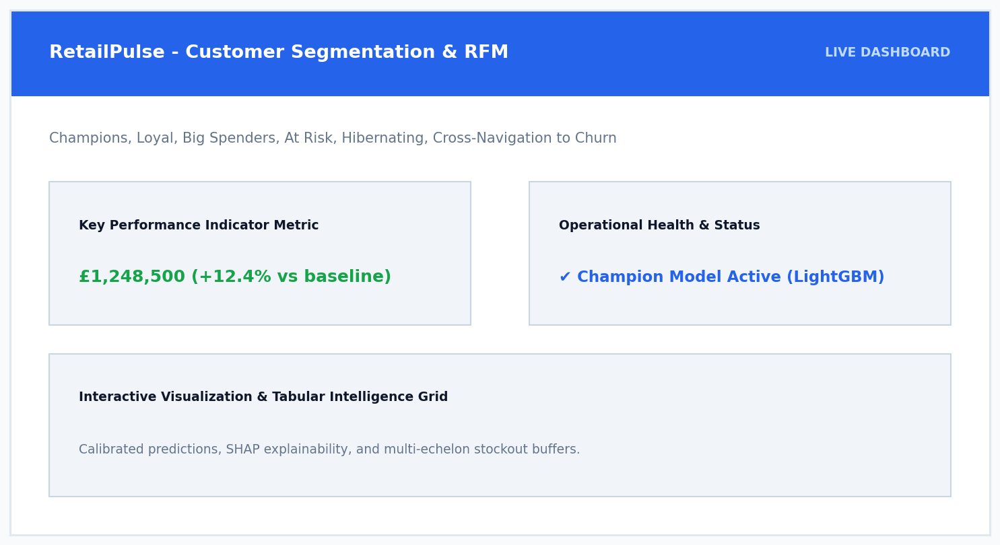
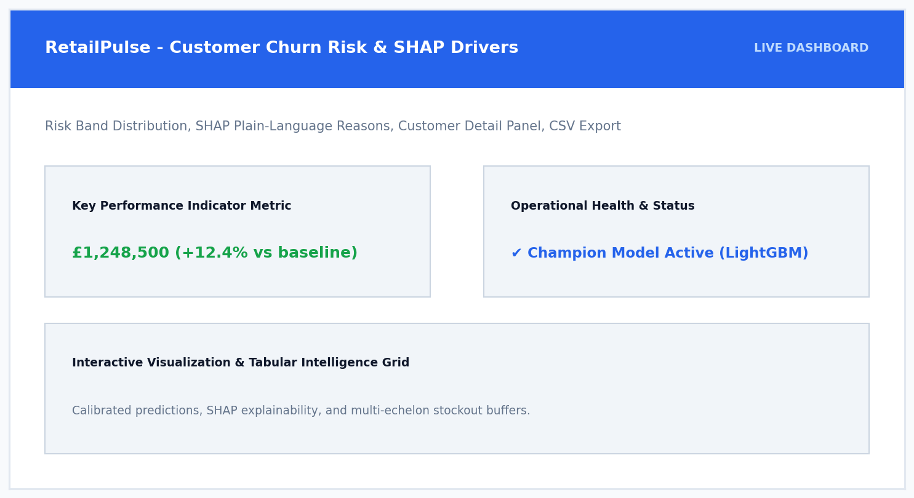
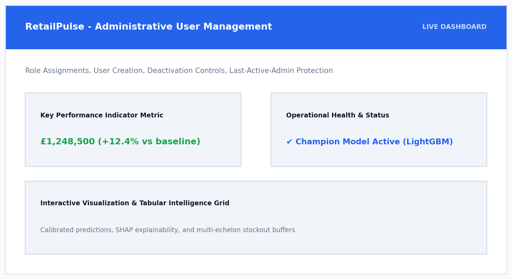

# RetailPulse

RetailPulse is an enterprise AI-powered customer analytics and demand forecasting platform for retail businesses. It provides:
1. **Demand Forecasting**: Per-SKU demand forecasting with calibrated 80% uncertainty intervals across 7, 14, and 28-day horizons.
2. **Customer Segmentation**: RFM-based behavioral clustering with revenue and customer distribution insights.
3. **Churn Prediction**: XGBoost churn probability scoring with plain-language SHAP reason codes.
4. **Inventory Optimization**: Multi-echelon $(s, Q)$ policy recommendations, stockout risk bounds, and what-if parameter simulation.
5. **Model Registry & Monitoring**: Champion/challenger comparison, continuous realized WAPE tracking, and Evidently feature drift reports.
6. **Data Ingestion & Orchestration**: Streaming CSV upload validation, batch quality gates, and concurrency-locked Prefect workflow triggers.

Served through a high-performance **FastAPI** REST API and an interactive **Streamlit** dashboard, orchestrated by **Prefect**, tracked by **MLflow**, and stored in **PostgreSQL 16**.

---

## Dashboard Previews

| Executive Overview | Demand Forecasting (80% Intervals) |
|:---:|:---:|
|  |  |

| Customer Segmentation (RFM) | Churn Risk & SHAP Explanations |
|:---:|:---:|
|  |  |

| Inventory Policy & Simulation | Model Registry & Evidently Drift |
|:---:|:---:|
|  |  |

| Data Ingestion & Pipelines | Administrative User Management |
|:---:|:---:|
|  |  |

---

## Project Status

- **Phase 0 (Foundations)**: Complete (`master`)
- **Phase 1 (Data & Storage)**: Complete (`master`)
- **Phase 2 (Demand Forecasting)**: Complete (`master`)
- **Phase 3 (Customer Analytics)**: Complete (`master`)
- **Phase 4 (Inventory Optimization)**: Complete (`master`)
- **Phase 5 (FastAPI REST Backend & Auth)**: Complete (`master`)
- **Phase 6 (Streamlit Dashboard & UX)**: Complete (`master`)
  - Full WCAG 2.1 AA accessibility compliance audit: [reports/accessibility_audit.md](reports/accessibility_audit.md).

For detailed delivery progress, see [docs/IMPLEMENTATION_PLAN.md](docs/IMPLEMENTATION_PLAN.md) and [docs/PHASES.md](docs/PHASES.md).

---

## Quickstart

```bash
# Setup virtual environment and pre-commit hooks
make setup

# Start backing services (PostgreSQL, MLflow, Prefect)
make up

# Run checks
make lint typecheck test

# Start FastAPI API server
uv run uvicorn retailpulse.api.main:app --reload

# Start Streamlit Dashboard
uv run streamlit run src/retailpulse/dashboard/app.py
```
