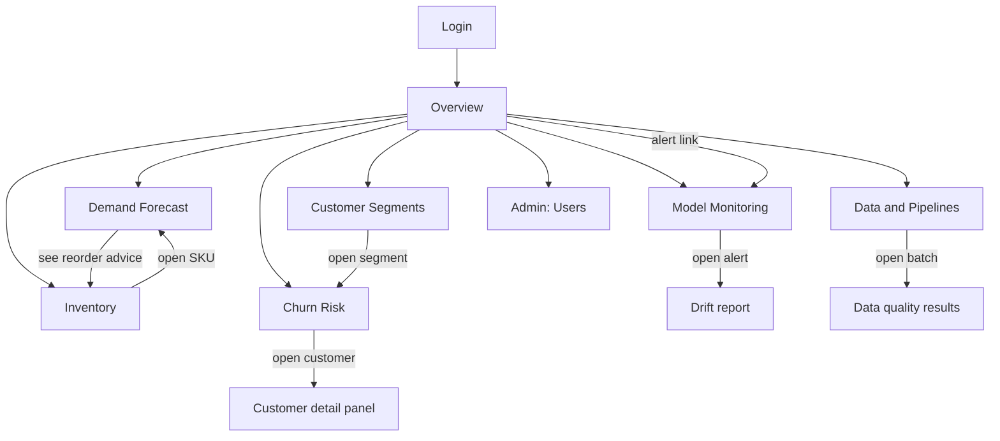
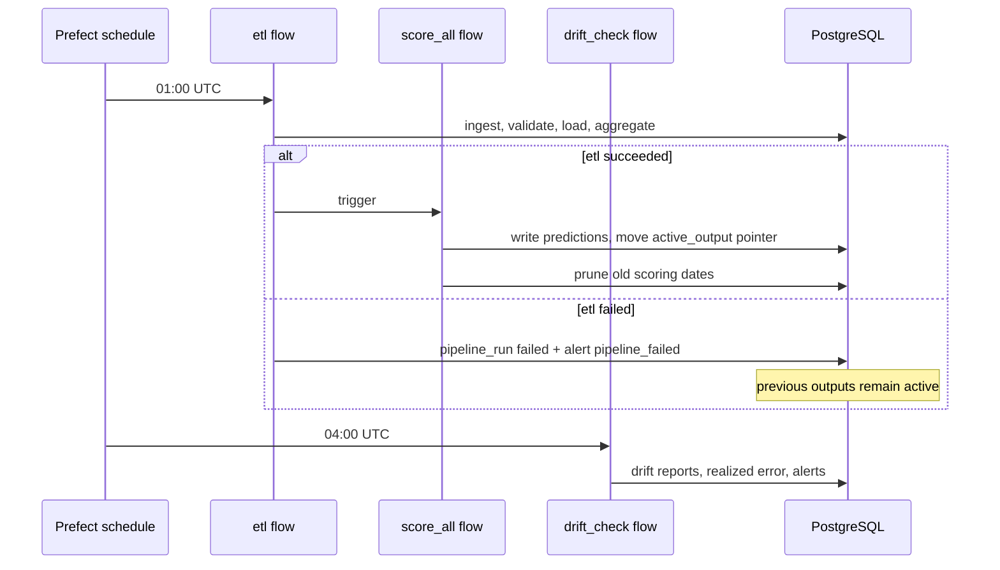
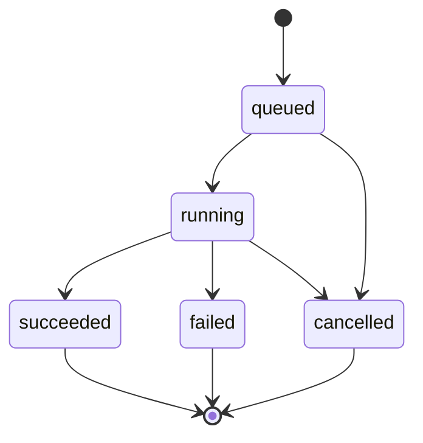

# RetailPulse — Application Flow

**Version:** 1.0 | **Related:** [DESIGN](DESIGN.md) · [API](API.md) · [PRD](PRD.md) · [ARCHITECTURE](ARCHITECTURE.md)

This file describes how people and the system move through RetailPulse: screens, journeys, background flows, states and failure paths. Screen layouts are in DESIGN.md; endpoints are in API.md.

---

## 1. Roles and permissions

| Capability | Viewer | Analyst | Admin |
|------------|:------:|:-------:|:-----:|
| View all dashboards and reports | ✔ | ✔ | ✔ |
| Export CSV (customers, inventory) | | ✔ | ✔ |
| Upload sales data | | ✔ | ✔ |
| Trigger `etl` and `score_all` | | ✔ | ✔ |
| What-if, save inventory parameters, run simulation | | ✔ | ✔ |
| Acknowledge alerts | | ✔ | ✔ |
| Train models, trigger `drift_check` | | | ✔ |
| Promote or roll back models | | | ✔ |
| Manage users | | | ✔ |
| See MLflow links | | | ✔ |

The UI hides actions a role cannot use; the API enforces the same matrix (hiding is never the control).

## 2. Navigation map

| Screen | Roles | Main API calls | Entry points | Exits |
|--------|-------|----------------|--------------|-------|
| Login | public | `POST /auth/login` | any unauthenticated access, session expiry | Overview |
| Overview | all | `/kpis/overview`, `/sales/daily`, `/inventory/recommendations`, `/segments`, `/alerts` | after login | any page |
| Demand Forecast | all | `/products`, `/sales/daily`, `/forecasts`, `/forecasts/accuracy` | nav, Inventory row, Overview | Inventory |
| Customer Segments | all | `/segments` | nav | Churn Risk (filtered) |
| Churn Risk | all (export: analyst+) | `/churn/summary`, `/customers`, `/customers/{id}`, `/customers/export` | nav, Segments | customer panel |
| Inventory | all (edit: analyst+) | `/inventory/*` | nav, Overview | Demand Forecast |
| Model Monitoring | all (actions: admin) | `/models`, `/monitoring/*`, `/alerts` | nav, Overview alert | drift report |
| Data and Pipelines | all (upload: analyst+) | `/uploads`, `/pipelines/*` | nav | batch quality results |
| Admin: Users | admin | `/users` | nav | none |

## 3. User journeys

Each journey lists **Actor**, **Trigger**, **Pre-conditions**, **Steps**, **Success** and **Alternates and errors**.

### J1. First-time setup (Admin, via CLI and dashboard)
- **Pre-conditions:** stack running (`make up`), migrations applied, dataset file downloaded into `data/raw/`.
1. Create the first admin: `retailpulse users create --email … --role admin` (password prompted, never echoed).
2. Load data: `retailpulse etl run --source online_retail_ii --path data/raw/<file>` (or upload via Data and Pipelines).
3. Seed synthetic inventory parameters: `retailpulse inventory seed-params`.
4. Sign in to the dashboard; open Model Monitoring; trigger training for forecast, segmentation, churn.
5. Review runs; promote the best runs; promotion triggers `score_all`.
6. Open Overview and confirm KPIs and data freshness.
- **Success:** every page shows data; status strip shows champion and last run OK.
- **Errors:** migrations not at head → `/health/ready` fails and the dashboard shows "Service not ready"; no champion → pages show the empty state with next-step guidance.

### J2. Sign-in and session
1. User opens the dashboard; no valid session → Login.
2. Submit credentials → `POST /auth/login` → token stored in server-side session state.
3. Navigation shows pages for the role.
4. On any 401 from the API, clear session and return to Login with "Your session expired. Please sign in again."
- **Alternates:** wrong credentials → generic message; 5 failures → lockout message; deactivated user → same generic message as wrong credentials.

### J3. Planner: daily reorder review
- **Actor:** Analyst. **Trigger:** start of day.
1. Overview: scan KPIs and the "Top 10 stockout risks" table; note the freshness strip.
2. Go to Inventory; filter `Status = Reorder now`, sort by stockout risk.
3. Select a SKU → view forecast with interval over the lead time, reorder point, on-hand.
4. (Optional) What-if: change lead time or service level → see recomputed quantity and risk.
5. (Optional) Save parameters → confirm dialog → saved with audit entry.
6. Export the filtered list as CSV for purchasing.
- **Success:** a reorder list is exported.
- **Alternates:** parameters shown as synthetic → notice remains visible; SKU `no_data` → explains why (not eligible) and shows no recommendation.

### J4. Marketer: churn campaign list
- **Actor:** Analyst. **Trigger:** campaign planning.
1. Customer Segments: identify "At Risk" or "Big Spenders" segments; open one → Churn Risk filtered by that segment.
2. Set band to High; read the distribution and counts.
3. Open a customer → read plain-language reasons and RFM.
4. Export CSV of the filtered list.
- **Success:** CSV with customer IDs, segment, probability, band, top reason.
- **Errors:** export fails → inline error with request ID and Retry.

### J5. Admin or analyst: upload new sales data
1. Data and Pipelines → choose file and source type.
2. Client-side hints (size, type) → submit → `POST /uploads/sales` → 202 with batch ID.
3. Page shows batch `queued → running` and auto-refreshes every 60 s.
4. On success: row counts and data-quality results are shown; `score_all` runs automatically.
- **Alternates:**
  - Same file already ingested → "This file was already loaded" with a link to the batch.
  - Missing required columns → 422 listing the columns; nothing queued.
  - Too large (413) or wrong type (415) → clear message with limits.
  - More than 20% of rows invalid → batch `rejected`; nothing loaded; quality results explain why.
  - Pipeline failure → batch `failed`; alert created; previous outputs still served.

### J6. Admin: train, compare, promote
1. Model Monitoring → Models tab → Train (choose task and algorithms) → confirm.
2. Pipeline run appears (`queued → running → succeeded`).
3. New runs show metrics, baseline comparison and **gate result**.
4. Select up to 4 runs → compare metrics side by side.
5. Promote a run that passed the gate → confirm dialog states the effect ("Scoring will re-run with this model") → 200.
6. `score_all` runs; status strip updates when it finishes.
- **Alternates:** run failed gate → Promote disabled with the reason; no run passes → alert `forecast_no_model_beats_baseline`, best baseline stays champion; rollback → promote the previous champion.

### J7. Admin: alert → investigate → act
1. Alert appears on Overview and Monitoring (e.g. `drift_detected`, `forecast_degraded`).
2. Open the alert → linked drift report or performance chart.
3. Decide: acknowledge (no action), or Train (J6).
4. Acknowledge → audit-logged; alert leaves the open list.

### J8. Executive: read-only overview
1. Sign in → Overview → read KPIs and trends.
2. Open Segments or Inventory for context. No write controls are visible.

### J9. Analyst: policy simulation
1. Inventory → Policy simulation → choose scope (ABC class, SKU limit ≤ 200) and baseline.
2. Run → results table (fill rate, stockout-day rate, avg inventory) for RetailPulse vs baseline, with the synthetic-data notice.
3. Result is stored; the latest result is visible to all roles.

## 4. System flows

### 4.1 Nightly operation

### 4.2 Weekly training
`train_forecast` (Sun 02:00), `train_segmentation` (03:00), `train_churn` (03:30) each log to MLflow, apply the gate and record the result. **They never change the champion.** An admin promotes (J6). If `RP_AUTO_PROMOTE=true`, a gate-passing run with better primary metric than the current champion is promoted automatically and audit-logged as `promote (auto)`.

### 4.3 Failure handling rules
| Failure | Behavior |
|---------|----------|
| Flow step raises | Retry up to 3× with backoff; then `pipeline_run.failed`, alert `pipeline_failed`, no pointer move |
| Prefect unreachable when API triggers | `pipeline_run` marked `failed`, API returns 503, UI shows "Scheduler unavailable" |
| MLflow unreachable | Training fails fast with alert; scoring and API reads continue (they do not need MLflow) |
| Database unavailable | `/health/ready` fails; dashboard shows "Service not ready"; flows retry |
| Data-quality gate fails | Batch `rejected` or `failed`; nothing loaded; previous data and outputs stay |

## 5. State machines

**Ingestion batch:** `queued → running → succeeded | failed | rejected`.
**Pipeline run:** `queued → running → succeeded | failed`, with `cancelled` from `queued` or `running`.
**Model run:** `running → succeeded | failed → archived`; `is_champion` is an independent flag (one per task).
**Alert:** `open → acknowledged`.

**Session:** `anonymous → authenticated (token valid) → expired or logged out → anonymous`. Token lifetime is `RP_JWT_EXPIRE_MINUTES`; there is no silent refresh in v1.0 (refresh tokens are v1.1).

## 6. Edge cases and empty states

| Situation | Expected behavior |
|-----------|-------------------|
| No data loaded yet | Pages show "No data yet" with a link to Data and Pipelines (analyst+) or "Ask an admin to load data" |
| Data loaded, no champion | Forecast, Churn, Segments, Inventory show "No model is active yet" and (admin only) a link to Monitoring |
| SKU not eligible for forecasting | Forecast page explains the rule (history or sales-day thresholds) |
| SKU with zero forecast on non-trading days | Chart shows zeros; note "Non-trading day" in the tooltip |
| Customer has no churn score (inactive over 365 days) | Customer panel says "Not scored (no purchase in the last 12 months)" |
| Anonymous sales (no customer ID) | Counted in demand and revenue KPIs, excluded from customer pages; Overview footnote explains |
| API slow (> 15 s) | Widget error card with Retry; other widgets still render |
| Concurrent trigger | 409 → "A run of this flow is already in progress" with link |
| Role changes or deactivation while signed in | Applies on the next request: the API reads role and active status from the database each time (SEC-AUTH-05). The dashboard refreshes `/auth/me` at the start of each script run (cached up to 60 s) and returns to Login on 401 |
| Browser back button after logout | Session cleared; protected pages redirect to Login |
