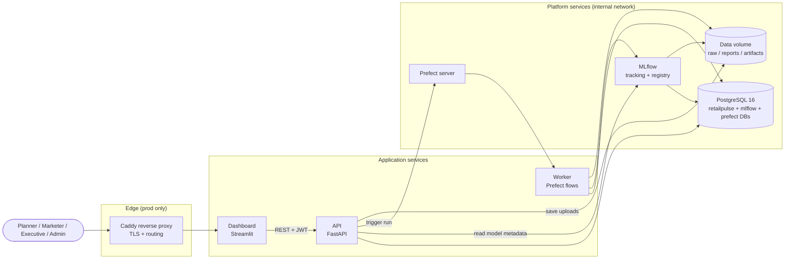
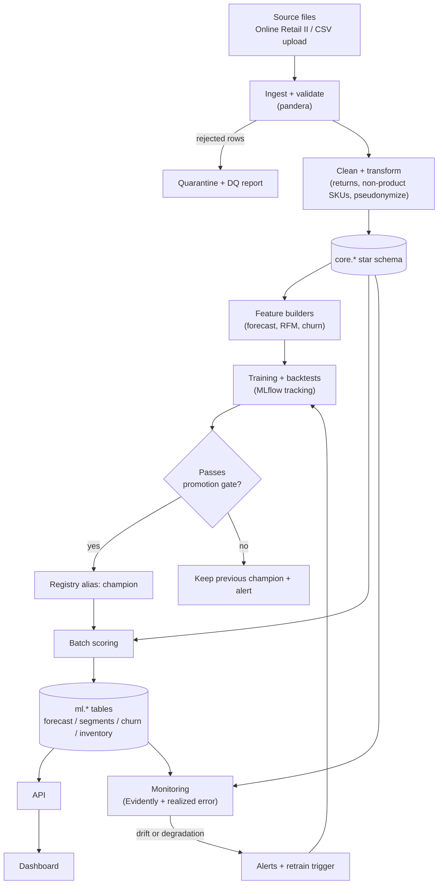
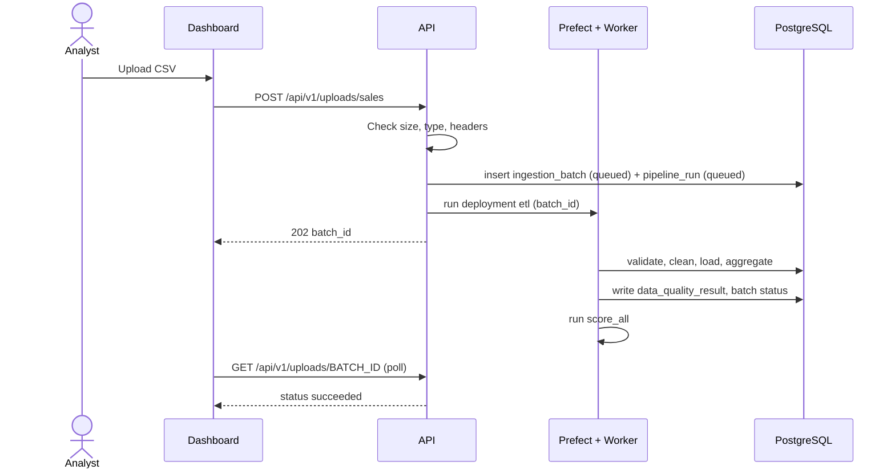
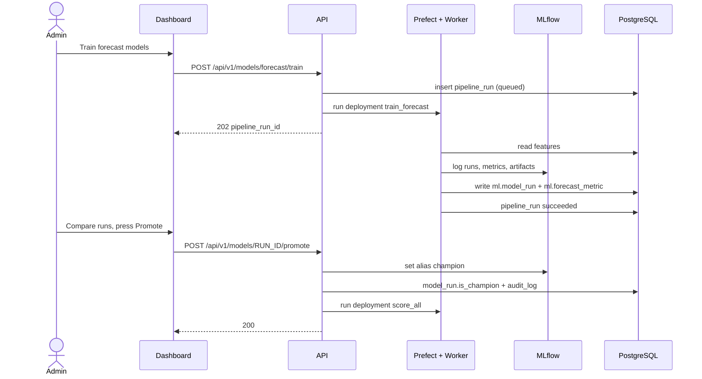

# RetailPulse — Architecture

**Version:** 1.0 | **Related:** [PRD](PRD.md) · [TRD](TRD.md) · [DATABASE](DATABASE.md) · [API](API.md) · [SECURITY](SECURITY.md)

Diagrams use Mermaid (renders on GitHub). When code and this file disagree, fix whichever is wrong in the same PR.

---

## 1. Principles

1. **Batch-first.** Forecasts, segments, churn scores and inventory recommendations are computed by scheduled batch jobs and stored in Postgres. The API reads stored results; it does not train or score on the request path.
2. **One source of truth per concern.** Postgres holds business data and predictions. MLflow holds experiments and model artifacts. `ops.pipeline_run` holds job state.
3. **Time-aware by construction.** ML code takes an `as_of` date; no wall-clock `today()`. All evaluation is time-based.
4. **Thin, replaceable seams.** Each volatile library (MLflow, Prefect, Evidently, Prophet) sits behind one module so upgrades touch one place.
5. **Safe failure.** A failed or rejected run never replaces the last good outputs.
6. **Secure by default, light by default.** Internal services are never public; API and dashboard images stay small.

## 2. System context and containers



| Service | Dockerfile | Port | Depends on | Published in prod |
|---------|-----------|------|------------|-------------------|
| `postgres` | official `postgres:16` | 5432 | none | No |
| `mlflow` | `infra/docker/mlflow.Dockerfile` | 5000 | postgres | No |
| `prefect` | official Prefect image (pinned) | 4200 | postgres | No |
| `worker` | `infra/docker/worker.Dockerfile` (heavy ML deps) | none | postgres, mlflow, prefect | No |
| `api` | `infra/docker/api.Dockerfile` (light) | 8000 | postgres, mlflow, prefect | Via proxy |
| `dashboard` | `infra/docker/dashboard.Dockerfile` (light) | 8501 | api | Via proxy |
| `caddy` (prod) | official `caddy:2` | 80, 443 | api, dashboard | Yes |

## 3. Data flow and ML lifecycle



## 4. Code structure and module boundaries

```
retailpulse/
├── CLAUDE.md  .cursorrules  README.md  Makefile  pyproject.toml  uv.lock  .env.example
├── docker-compose.yml  docker-compose.override.yml  docker-compose.prod.yml
├── .github/workflows/        ci.yml  security.yml  cd.yml
├── config/                   non_product_skus.yaml
├── docs/                     (this spec set)
├── infra/                    docker/  caddy/Caddyfile  k8s/ (stretch)
├── migrations/               Alembic
├── data/                     raw/ interim/ processed/ reports/   (git-ignored)
├── reports/                  committed result write-ups (markdown)
├── scripts/                  make_fixture.py and other one-off helpers
├── src/retailpulse/
│   ├── config.py  logging.py  errors.py  timeutil.py  cli.py
│   ├── db/            session.py  models/  repositories/
│   ├── security/      passwords.py  tokens.py  rbac.py  pseudonymize.py  csv_safety.py
│   ├── ingestion/     adapters/ (online_retail_ii.py, generic_csv.py)  schemas.py  loaders.py
│   ├── etl/           clean.py  transform.py  aggregate.py  quality.py
│   ├── features/      forecast_features.py  rfm.py  churn_features.py
│   ├── ml/
│   │   ├── registry.py  runs.py
│   │   ├── forecasting/   base.py baselines.py prophet_model.py lgbm_model.py lstm_model.py
│   │   │                  backtest.py metrics.py intervals.py train.py predict.py
│   │   ├── segmentation/  train.py labels.py predict.py
│   │   ├── churn/         labels.py train.py explain.py predict.py
│   │   └── inventory/     policy.py params.py recommend.py simulate.py
│   ├── monitoring/    drift.py  performance.py  alerts.py
│   ├── pipelines/     flows.py  triggers.py  schedules.py
│   ├── api/           main.py deps.py errors.py middleware.py pagination.py schemas/ routers/
│   └── dashboard/     app.py  client.py  theme.py  components/  views/
└── tests/             unit/  integration/  e2e/  fixtures/
```

### Dependency rules (enforce with `import-linter` in CI)

| Package | May import | Must NOT import |
|---------|-----------|-----------------|
| `config`, `logging`, `errors` | stdlib and third-party only | anything in `retailpulse` |
| `db`, `security` | the row above | `api`, `dashboard`, `ml`, `pipelines` |
| `ingestion`, `etl`, `features` | `db`, `security`, row above | `api`, `dashboard`, `pipelines`, `ml` |
| `ml`, `monitoring` | `db`, `features`, row above | `api`, `dashboard`, `pipelines` |
| `pipelines` | everything below it | `api`, `dashboard` |
| `api` | `db`, `security`, `pipelines.triggers`, `ml.registry` (read), `ml.inventory.policy`/`simulate` | `ml.*.train`, `ml.forecasting.*_model`, `dashboard` |
| `dashboard` | its own package only | `db`, `ml`, `api`, `pipelines` |

**Light-image rule:** `ml/__init__.py` and `ml/inventory/policy.py` import only numpy/scipy/pandas. Heavy libraries (torch, prophet, lightgbm, shap, evidently) are imported inside the modules that need them, never at package import time, so the API image does not need them.

**Clock rule:** `retailpulse/timeutil.py` (`utc_now()`) is the only module that reads the system clock. `ml`, `features` and `etl` must not import it; they receive `as_of` instead (CODE_STYLE §1).

### Key seams
- `ml/registry.py` is the only module that imports `mlflow`.
- `monitoring/drift.py` is the only module that imports `evidently`.
- `pipelines/` is the only package that imports `prefect`.
- `ml/forecasting/prophet_model.py` is the only module that imports `prophet`.
- `security/` is the only package that hashes passwords, signs tokens or pseudonymizes IDs.

## 5. Key sequences

### 5.1 Upload → ETL → scoring


### 5.2 Train → compare → promote


## 6. Orchestration and schedules

`ops.pipeline_run` is the system of record for job state. Flows update it at start, on each step and at the end. The API creates the row (`queued`) before triggering Prefect, so the dashboard can show runs even if Prefect is down.

| Flow | Triggers | Schedule (UTC) | Steps |
|------|----------|----------------|-------|
| `etl` | schedule, upload, manual | daily 01:00 | ingest new files → validate → clean → load → aggregate → data-quality results |
| `score_all` | after `etl` succeeds, after promote, manual | chained | forecast → segmentation → churn → inventory recommendations |
| `train_forecast` | schedule, alert, manual | Sun 02:00 | features → backtests → gate → register |
| `train_segmentation` | schedule, manual | Sun 03:00 | RFM → clustering → labels → register |
| `train_churn` | schedule, alert, manual | Sun 03:30 | cutoffs → features → models → calibrate → register |
| `drift_check` | schedule, manual | daily 04:00 | drift reports → realized error → alerts |

Rules: one active run per flow; retries 3× with exponential backoff; per-step timeouts; failure creates an `ops.alert` and leaves previous outputs in place. **Replay mode** (`retailpulse replay`) holds back the last 60 days and releases one day per scheduled run so scheduled operation and drift can be demonstrated on a static dataset.

## 7. Model lifecycle and registry strategy

1. Training flow logs a run to MLflow and mirrors a summary into `ml.model_run` (status `succeeded`, `is_champion=false`).
2. Gate results are stored in the run's metrics (`gate_passed`, `gate_reason`).
3. An admin promotes a run: alias `champion` moves to it, `previous_champion` to the old one, `ml.model_run.is_champion` flips (partial unique index guarantees one champion per task), audit log entry written, `score_all` triggered.
4. Rollback = promote `previous_champion`.
5. Local models (baselines, Prophet) store config and backtest artifacts and are refit at scoring time; global models (LightGBM, LSTM) store weights.

## 8. Deployment topologies

| Topology | When | Notes |
|----------|------|-------|
| **A. Local dev** | Daily development | `make up` for Postgres, MLflow, Prefect; run API and dashboard on the host with reload |
| **B. Single VM + Compose + Caddy** (default for the demo) | Phase 8 | One 4 vCPU / 8 GB VM; only 80/443 open; Caddy terminates TLS; secrets from env files with `0600` permissions; nightly `pg_dump` backup |
| **C. Managed services** | Optional | API and dashboard on a container platform; managed Postgres; object storage for MLflow artifacts; scheduled jobs for flows |
| **D. Kubernetes** (stretch) | After Phase 9 | See mapping below |

Kubernetes mapping (stretch): `api`, `dashboard`, `mlflow`, `prefect` → Deployments + Services; `worker` → Deployment (or Jobs per flow); schedules → Prefect schedules or CronJobs; Postgres → managed service or StatefulSet; secrets → Secrets; ingress → Ingress with TLS; HPA on `api`; NetworkPolicies to keep MLflow, Prefect and Postgres internal. Local test with kind.

## 9. Cross-cutting concerns

- **Config:** one `Settings` object (TRD §3).
- **Logging:** structlog JSON; `request_id` bound per request (middleware) and per flow run.
- **Errors:** domain exceptions → RFC 9457 problem responses in the API.
- **AuthN/Z:** JWT bearer; `require_role(...)` dependency; roles `viewer < analyst < admin`.
- **Caching:** API in-process TTL cache (60 s) for KPI aggregates and champion metadata; dashboard `st.cache_data` with role in the key.
- **Transactions:** one transaction per load chunk. Scoring jobs write prediction rows and then move the `ml.active_output` pointer in the same transaction; the API reads only through the `ml.v_active_*` views, so a failed job never changes what is served.
- **Idempotency:** unique keys and upserts; file hash dedupe for uploads.
- **Observability:** `/metrics`, `ops.pipeline_run`, MLflow, Evidently HTML reports.

## 10. Scaling path (documented, not built)

| Pressure | Change |
|----------|--------|
| More rows (≥ 10×) | Partition `fact_sales_line` by month; compute features with DuckDB or Polars; keep Postgres for serving |
| More SKUs or stores | Shard training by series groups; LightGBM stays global; move Prophet to batch workers |
| More users | Run multiple API replicas; move rate limiting to Redis; add read replica |
| Real-time data | Add a message queue (Kafka) feeding the same canonical sales schema; micro-batch ETL |
| Feature reuse | Introduce a feature store |
| Model serving | Serve global models behind a dedicated inference service |

## 11. Architecture decision records (short form)

| ID | Decision | Why | Revisit when |
|----|----------|-----|--------------|
| ADR-001 | Modular monolith package, several processes | Simple to build and test solo; clear boundaries | Teams or deploy cadence diverge |
| ADR-002 | PostgreSQL for business data and predictions | One system to operate; enough for ~1M rows | Analytics queries dominate |
| ADR-003 | Batch scoring, API reads results | Forecasts and segments are naturally batch; fast, simple API | Real-time personalization needed |
| ADR-004 | MLflow aliases for champion + DB mirror | Registry is the truth for models; DB mirror keeps API light | MLflow API changes force rework |
| ADR-005 | Thin internal `Forecaster` interface, no Darts | Fewer dependency conflicts; clearer methodology | Many more model families needed |
| ADR-006 | Dashboard is a pure API client | Single security boundary; testable | Dashboard framework replaced |
| ADR-007 | `data_as_of` and time-based splits everywhere | Prevents leakage; works on historical data | Never |
| ADR-008 | Prefect orchestrates; DB is system of record | Retries, schedules, UI; state survives Prefect outages | DAGs become complex (consider Airflow/Dagster) |
| ADR-009 | Sync SQLAlchemy and plain `def` endpoints | Simpler; adequate load | Profiling shows I/O concurrency limits |
| ADR-010 | Separate dependency groups and images | Light API and dashboard; heavy worker | Image count becomes a burden |
| ADR-011 | Compose-on-VM as default deployment | Cheapest, simplest, reproducible | Need HA or autoscaling |
