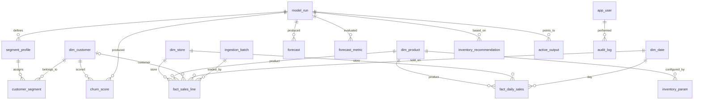

# RetailPulse — Database Design

**Version:** 1.0 | **Engine:** PostgreSQL 16 | **Related:** [TRD](TRD.md) · [ARCHITECTURE](ARCHITECTURE.md) · [API](API.md) · [SECURITY](SECURITY.md)

This is the contract for the `retailpulse` database. Implement it with SQLAlchemy 2.0 models and Alembic migrations (§9). The SQL below is the **specification**; generated migrations must produce an equivalent schema. If the code needs a schema change, update this file in the same PR.

---

## 1. Conventions

- **Schemas:** `app` (users), `ops` (jobs, quality, monitoring, audit), `core` (business data, star schema), `ml` (model runs and predictions).
- **Names:** `snake_case`, singular table names, prefixes `dim_`, `fact_`. Constraint names follow the SQLAlchemy convention below.
- **Keys:** `BIGINT GENERATED ALWAYS AS IDENTITY` for dimension and fact surrogate keys; `UUID` (`gen_random_uuid()`) for runs, batches, reports and users.
- **Money and quantities:** `NUMERIC`, never `FLOAT`. Metrics may use `DOUBLE PRECISION`.
- **Time:** `timestamptz` in UTC for system timestamps. `core.fact_sales_line.invoice_ts` is the one exception: source-local, timezone-naive `timestamp`.
- **Enumerations:** `TEXT` + `CHECK` constraints (easier to migrate than native enums).
- **JSONB:** only for free-form details (`details`, `params`, `metrics`, `summary`, `top_reasons`). Business keys never live inside JSONB.
- **Deletes:** no soft deletes. Users are deactivated with `is_active`. Prediction rows are pruned by retention (§8).
- **Customer identity:** only pseudonymous keys are stored (`core.dim_customer.customer_key`).

```python
NAMING_CONVENTION = {
    "ix": "ix_%(column_0_label)s",
    "uq": "uq_%(table_name)s_%(column_0_name)s",
    "ck": "ck_%(table_name)s_%(constraint_name)s",
    "fk": "fk_%(table_name)s_%(column_0_name)s_%(referred_table_name)s",
    "pk": "pk_%(table_name)s",
}
```

## 2. Entity relationship overview



## 3. Bootstrap

```sql
CREATE EXTENSION IF NOT EXISTS citext;
CREATE EXTENSION IF NOT EXISTS pg_trgm;
CREATE SCHEMA IF NOT EXISTS app;
CREATE SCHEMA IF NOT EXISTS ops;
CREATE SCHEMA IF NOT EXISTS core;
CREATE SCHEMA IF NOT EXISTS ml;
```

**Creation order matters because of foreign keys:** `app` → `ops` base tables → `core` → `ml` → `ops` monitoring tables → views.

## 4. `app` schema

```sql
CREATE TABLE app.app_user (
    user_id            UUID PRIMARY KEY DEFAULT gen_random_uuid(),
    email              CITEXT NOT NULL UNIQUE,
    full_name          TEXT,
    password_hash      TEXT NOT NULL,                 -- argon2id; never log or return
    role               TEXT NOT NULL CHECK (role IN ('admin','analyst','viewer')),
    is_active          BOOLEAN NOT NULL DEFAULT TRUE,
    failed_login_count SMALLINT NOT NULL DEFAULT 0,
    locked_until       TIMESTAMPTZ,
    last_login_at      TIMESTAMPTZ,
    created_at         TIMESTAMPTZ NOT NULL DEFAULT now(),
    updated_at         TIMESTAMPTZ NOT NULL DEFAULT now()
);
```
(`user` is a reserved word in PostgreSQL, hence `app_user`.)

## 5. `ops` schema, base tables

```sql
CREATE TABLE ops.ingestion_batch (
    batch_id           UUID PRIMARY KEY DEFAULT gen_random_uuid(),
    source_name        TEXT NOT NULL,                 -- 'online_retail_ii' | 'generic_csv'
    source_file        TEXT NOT NULL,                 -- stored name, never a user path
    original_filename  TEXT,
    file_sha256        CHAR(64) NOT NULL,
    row_count_in       INTEGER,
    row_count_loaded   INTEGER,
    row_count_rejected INTEGER,
    status             TEXT NOT NULL CHECK (status IN ('queued','running','succeeded','failed','rejected')),
    error              TEXT,
    uploaded_by        UUID REFERENCES app.app_user(user_id) ON DELETE SET NULL,
    created_at         TIMESTAMPTZ NOT NULL DEFAULT now(),
    started_at         TIMESTAMPTZ,
    finished_at        TIMESTAMPTZ,
    UNIQUE (source_name, file_sha256)                 -- same file is not ingested twice
);

CREATE TABLE ops.pipeline_run (
    run_id              UUID PRIMARY KEY DEFAULT gen_random_uuid(),
    flow_name           TEXT NOT NULL CHECK (flow_name IN
                          ('etl','score_all','train_forecast','train_segmentation','train_churn','drift_check')),
    trigger             TEXT NOT NULL CHECK (trigger IN ('schedule','manual','upload','alert','promote')),
    status              TEXT NOT NULL CHECK (status IN ('queued','running','succeeded','failed','cancelled')),
    params              JSONB NOT NULL DEFAULT '{}'::jsonb,
    prefect_flow_run_id TEXT,
    requested_by        UUID REFERENCES app.app_user(user_id) ON DELETE SET NULL,
    error               TEXT,
    queued_at           TIMESTAMPTZ NOT NULL DEFAULT now(),
    started_at          TIMESTAMPTZ,
    finished_at         TIMESTAMPTZ
);
-- At most one active run per flow (API answers 409 on conflict)
CREATE UNIQUE INDEX uq_pipeline_run_active ON ops.pipeline_run (flow_name)
    WHERE status IN ('queued','running');
CREATE INDEX ix_pipeline_run_flow_time ON ops.pipeline_run (flow_name, queued_at DESC);

CREATE TABLE ops.data_quality_result (
    result_id     BIGINT GENERATED ALWAYS AS IDENTITY PRIMARY KEY,
    batch_id      UUID NOT NULL REFERENCES ops.ingestion_batch(batch_id) ON DELETE CASCADE,
    check_name    TEXT NOT NULL,                      -- e.g. 'duplicate_rows_removed', 'null_sku', 'non_positive_price'
    severity      TEXT NOT NULL CHECK (severity IN ('info','warning','error')),
    passed        BOOLEAN NOT NULL,
    affected_rows INTEGER NOT NULL DEFAULT 0,
    details       JSONB NOT NULL DEFAULT '{}'::jsonb,
    created_at    TIMESTAMPTZ NOT NULL DEFAULT now()
);
CREATE INDEX ix_dq_batch ON ops.data_quality_result (batch_id);
```

## 6. `core` schema

```sql
CREATE TABLE core.dim_store (
    store_id   SMALLINT GENERATED ALWAYS AS IDENTITY PRIMARY KEY,
    store_code TEXT NOT NULL UNIQUE,
    store_name TEXT NOT NULL,
    country    TEXT,
    created_at TIMESTAMPTZ NOT NULL DEFAULT now()
);
-- Seed in migration: ('ONLINE', 'Online store', 'GB')

CREATE TABLE core.dim_product (
    product_id      BIGINT GENERATED ALWAYS AS IDENTITY PRIMARY KEY,
    sku             TEXT NOT NULL UNIQUE,
    description     TEXT,
    category        TEXT,
    is_product      BOOLEAN NOT NULL DEFAULT TRUE,    -- FALSE for postage, fees, adjustments
    unit_cost_est   NUMERIC(12,4),                    -- assumption, not source data
    abc_class       CHAR(1) CHECK (abc_class IN ('A','B','C')),
    xyz_class       CHAR(1) CHECK (xyz_class IN ('X','Y','Z')),
    first_sale_date DATE,
    last_sale_date  DATE,
    created_at      TIMESTAMPTZ NOT NULL DEFAULT now(),
    updated_at      TIMESTAMPTZ NOT NULL DEFAULT now()
);
CREATE INDEX ix_dim_product_desc_trgm ON core.dim_product USING gin (description gin_trgm_ops);
CREATE INDEX ix_dim_product_abc ON core.dim_product (abc_class) WHERE is_product;

CREATE TABLE core.dim_customer (
    customer_id      BIGINT GENERATED ALWAYS AS IDENTITY PRIMARY KEY,
    customer_key     TEXT NOT NULL UNIQUE,            -- HMAC-SHA256(salt, source id), hex; never the raw id
    country          TEXT,
    first_order_date DATE,
    last_order_date  DATE,
    created_at       TIMESTAMPTZ NOT NULL DEFAULT now(),
    updated_at       TIMESTAMPTZ NOT NULL DEFAULT now()
);

CREATE TABLE core.dim_date (
    date_key       DATE PRIMARY KEY,
    year           SMALLINT NOT NULL,
    quarter        SMALLINT NOT NULL,
    month          SMALLINT NOT NULL,
    iso_week       SMALLINT NOT NULL,
    day_of_week    SMALLINT NOT NULL,                 -- ISO: 1 = Monday .. 7 = Sunday
    day_of_month   SMALLINT NOT NULL,
    is_weekend     BOOLEAN NOT NULL,
    is_holiday     BOOLEAN NOT NULL DEFAULT FALSE,    -- GB public holidays (holidays package)
    holiday_name   TEXT,
    is_trading_day BOOLEAN NOT NULL DEFAULT TRUE,     -- derived, see TRD §4.4
    is_complete    BOOLEAN NOT NULL DEFAULT TRUE      -- FALSE for a partial final day (excluded from aggregates)
);
-- Populated by the ETL (ensure_dim_date) for 2009-01-01 through 2013-12-31.

CREATE TABLE core.fact_sales_line (
    sales_line_id   BIGINT GENERATED ALWAYS AS IDENTITY PRIMARY KEY,
    batch_id        UUID NOT NULL REFERENCES ops.ingestion_batch(batch_id),
    source_row_hash CHAR(64) NOT NULL UNIQUE,         -- idempotent loads: ON CONFLICT DO NOTHING
    invoice_no      TEXT NOT NULL,
    invoice_ts      TIMESTAMP NOT NULL,               -- source-local, naive
    date_key        DATE NOT NULL REFERENCES core.dim_date(date_key),
    store_id        SMALLINT NOT NULL REFERENCES core.dim_store(store_id),
    product_id      BIGINT NOT NULL REFERENCES core.dim_product(product_id),
    customer_id     BIGINT REFERENCES core.dim_customer(customer_id),   -- NULL when source has none
    quantity        INTEGER NOT NULL,
    unit_price      NUMERIC(12,4) NOT NULL CHECK (unit_price > 0),
    line_amount     NUMERIC(14,4) GENERATED ALWAYS AS (quantity * unit_price) STORED,
    is_return       BOOLEAN NOT NULL DEFAULT FALSE,
    is_outlier      BOOLEAN NOT NULL DEFAULT FALSE,   -- quantity >= OUTLIER_QTY; excluded from aggregates
    currency        CHAR(3) NOT NULL DEFAULT 'GBP',
    CHECK ((is_return AND quantity < 0) OR (NOT is_return AND quantity > 0))
);
CREATE INDEX ix_fsl_date ON core.fact_sales_line (date_key);
CREATE INDEX ix_fsl_product_date ON core.fact_sales_line (product_id, date_key);
CREATE INDEX ix_fsl_customer_date ON core.fact_sales_line (customer_id, date_key) WHERE customer_id IS NOT NULL;
CREATE INDEX ix_fsl_batch ON core.fact_sales_line (batch_id);

CREATE TABLE core.fact_daily_sales (
    date_key       DATE NOT NULL REFERENCES core.dim_date(date_key),
    store_id       SMALLINT NOT NULL REFERENCES core.dim_store(store_id),
    product_id     BIGINT NOT NULL REFERENCES core.dim_product(product_id),
    units_sold     INTEGER NOT NULL DEFAULT 0,        -- demand: positive, non-outlier sales only
    units_returned INTEGER NOT NULL DEFAULT 0,        -- absolute value of returns
    net_units      INTEGER GENERATED ALWAYS AS (units_sold - units_returned) STORED,
    revenue        NUMERIC(14,4) NOT NULL DEFAULT 0,  -- sales amount, excluding returns
    avg_unit_price NUMERIC(12,4),
    n_orders       INTEGER NOT NULL DEFAULT 0,
    PRIMARY KEY (date_key, store_id, product_id)
);
CREATE INDEX ix_fds_product_date ON core.fact_daily_sales (product_id, store_id, date_key);
-- Sparse: only days with activity are stored. Zero-fill trading days in code (features/forecast_features.py).
-- Excludes is_outlier lines and days where dim_date.is_complete is false.

CREATE TABLE core.inventory_param (
    product_id         BIGINT NOT NULL REFERENCES core.dim_product(product_id),
    store_id           SMALLINT NOT NULL REFERENCES core.dim_store(store_id),
    lead_time_days     NUMERIC(5,1) NOT NULL CHECK (lead_time_days > 0),
    lead_time_std_days NUMERIC(5,2) NOT NULL DEFAULT 0 CHECK (lead_time_std_days >= 0),
    service_level      NUMERIC(4,3) NOT NULL DEFAULT 0.950 CHECK (service_level > 0.5 AND service_level < 1),
    unit_cost          NUMERIC(12,4) CHECK (unit_cost >= 0),
    holding_cost_rate  NUMERIC(5,4) NOT NULL DEFAULT 0.2000 CHECK (holding_cost_rate >= 0),  -- annual fraction of unit cost
    order_cost         NUMERIC(12,4) NOT NULL DEFAULT 25 CHECK (order_cost >= 0),
    moq                INTEGER NOT NULL DEFAULT 1 CHECK (moq >= 1),
    source             TEXT NOT NULL DEFAULT 'synthetic' CHECK (source IN ('synthetic','user','upload')),
    updated_by         UUID REFERENCES app.app_user(user_id) ON DELETE SET NULL,
    updated_at         TIMESTAMPTZ NOT NULL DEFAULT now(),
    PRIMARY KEY (product_id, store_id)
);

CREATE TABLE core.inventory_snapshot (
    snapshot_date DATE NOT NULL REFERENCES core.dim_date(date_key),
    store_id      SMALLINT NOT NULL REFERENCES core.dim_store(store_id),
    product_id    BIGINT NOT NULL REFERENCES core.dim_product(product_id),
    on_hand       INTEGER NOT NULL CHECK (on_hand >= 0),
    on_order      INTEGER NOT NULL DEFAULT 0 CHECK (on_order >= 0),
    source        TEXT NOT NULL DEFAULT 'synthetic' CHECK (source IN ('synthetic','upload')),
    PRIMARY KEY (snapshot_date, store_id, product_id)
);
```

## 7. `ml` schema

```sql
CREATE TABLE ml.model_run (
    run_id               UUID PRIMARY KEY DEFAULT gen_random_uuid(),
    task                 TEXT NOT NULL CHECK (task IN ('forecast','segmentation','churn')),
    algorithm            TEXT NOT NULL,               -- 'seasonal_naive','prophet','lightgbm','lstm','kmeans','logreg', ...
    mlflow_run_id        TEXT NOT NULL,
    mlflow_model_name    TEXT,
    mlflow_model_version TEXT,
    status               TEXT NOT NULL CHECK (status IN ('running','succeeded','failed','archived')),
    is_champion          BOOLEAN NOT NULL DEFAULT FALSE,
    data_start           DATE,
    data_end             DATE,
    params               JSONB NOT NULL DEFAULT '{}'::jsonb,
    metrics              JSONB NOT NULL DEFAULT '{}'::jsonb,   -- includes gate_passed, gate_reason
    git_sha              TEXT,
    dataset_hash         TEXT,
    seed                 INTEGER,
    trained_at           TIMESTAMPTZ NOT NULL DEFAULT now(),
    trained_by           UUID REFERENCES app.app_user(user_id) ON DELETE SET NULL
);
CREATE UNIQUE INDEX uq_model_run_champion ON ml.model_run (task) WHERE is_champion;  -- one champion per task
CREATE INDEX ix_model_run_task_time ON ml.model_run (task, trained_at DESC);

CREATE TABLE ml.forecast (
    model_run_id   UUID NOT NULL REFERENCES ml.model_run(run_id) ON DELETE CASCADE,
    store_id       SMALLINT NOT NULL REFERENCES core.dim_store(store_id),
    product_id     BIGINT NOT NULL REFERENCES core.dim_product(product_id),
    origin_date    DATE NOT NULL,                     -- = data_as_of when generated
    target_date    DATE NOT NULL,
    horizon_day    SMALLINT NOT NULL CHECK (horizon_day >= 1),
    yhat           NUMERIC(14,4) NOT NULL CHECK (yhat >= 0),
    yhat_lower     NUMERIC(14,4) NOT NULL CHECK (yhat_lower >= 0),
    yhat_upper     NUMERIC(14,4) NOT NULL,
    interval_level NUMERIC(3,2) NOT NULL DEFAULT 0.80,
    generated_at   TIMESTAMPTZ NOT NULL DEFAULT now(),
    PRIMARY KEY (model_run_id, store_id, product_id, origin_date, target_date),
    CHECK (yhat_lower <= yhat AND yhat <= yhat_upper)
);
CREATE INDEX ix_forecast_lookup ON ml.forecast (product_id, store_id, target_date);

CREATE TABLE ml.forecast_metric (
    model_run_id UUID NOT NULL REFERENCES ml.model_run(run_id) ON DELETE CASCADE,
    scope        TEXT NOT NULL CHECK (scope IN ('global','abc','horizon','sku')),
    scope_key    TEXT NOT NULL,                       -- 'all' | 'A' | '1-7' | product_id
    metric       TEXT NOT NULL CHECK (metric IN
                   ('wape','smape','mase','rmsse','bias','rmse','mae','coverage','pinball')),
    value        DOUBLE PRECISION NOT NULL,
    n_series     INTEGER,
    PRIMARY KEY (model_run_id, scope, scope_key, metric)
);

CREATE TABLE ml.segment_profile (
    model_run_id     UUID NOT NULL REFERENCES ml.model_run(run_id) ON DELETE CASCADE,
    as_of_date       DATE NOT NULL,
    segment_id       SMALLINT NOT NULL,
    segment_label    TEXT NOT NULL,
    n_customers      INTEGER NOT NULL,
    avg_recency_days NUMERIC(8,2) NOT NULL,
    avg_frequency    NUMERIC(8,2) NOT NULL,
    avg_monetary     NUMERIC(14,2) NOT NULL,
    revenue_share    NUMERIC(6,5) NOT NULL,
    PRIMARY KEY (model_run_id, as_of_date, segment_id)
);

CREATE TABLE ml.customer_segment (
    model_run_id UUID NOT NULL,
    as_of_date   DATE NOT NULL,
    customer_id  BIGINT NOT NULL REFERENCES core.dim_customer(customer_id),
    segment_id   SMALLINT NOT NULL,
    recency_days INTEGER NOT NULL,
    frequency    INTEGER NOT NULL,
    monetary     NUMERIC(14,2) NOT NULL,
    r_score      SMALLINT,
    f_score      SMALLINT,
    m_score      SMALLINT,
    PRIMARY KEY (model_run_id, as_of_date, customer_id),
    FOREIGN KEY (model_run_id, as_of_date, segment_id)
        REFERENCES ml.segment_profile (model_run_id, as_of_date, segment_id) ON DELETE CASCADE
);
CREATE INDEX ix_customer_segment_seg ON ml.customer_segment (model_run_id, as_of_date, segment_id);

CREATE TABLE ml.churn_score (
    model_run_id      UUID NOT NULL REFERENCES ml.model_run(run_id) ON DELETE CASCADE,
    as_of_date        DATE NOT NULL,
    customer_id       BIGINT NOT NULL REFERENCES core.dim_customer(customer_id),
    churn_probability NUMERIC(6,5) NOT NULL CHECK (churn_probability BETWEEN 0 AND 1),
    risk_band         TEXT NOT NULL CHECK (risk_band IN ('low','medium','high')),
    top_reasons       JSONB NOT NULL DEFAULT '[]'::jsonb,   -- [{"feature","value","impact","direction"}]
    scored_at         TIMESTAMPTZ NOT NULL DEFAULT now(),
    PRIMARY KEY (model_run_id, as_of_date, customer_id)
);
CREATE INDEX ix_churn_band_prob ON ml.churn_score (model_run_id, as_of_date, risk_band, churn_probability DESC);

CREATE TABLE ml.inventory_recommendation (
    forecast_run_id       UUID NOT NULL REFERENCES ml.model_run(run_id) ON DELETE CASCADE,
    store_id              SMALLINT NOT NULL REFERENCES core.dim_store(store_id),
    product_id            BIGINT NOT NULL REFERENCES core.dim_product(product_id),
    as_of_date            DATE NOT NULL,
    on_hand               INTEGER NOT NULL,
    on_order              INTEGER NOT NULL,
    lead_time_days        NUMERIC(5,1) NOT NULL,
    service_level         NUMERIC(4,3) NOT NULL,
    demand_mean_lt        NUMERIC(14,4) NOT NULL,      -- mu_L
    demand_std_lt         NUMERIC(14,4) NOT NULL,      -- sigma_L
    safety_stock          NUMERIC(14,4) NOT NULL,
    reorder_point         NUMERIC(14,4) NOT NULL,
    recommended_order_qty INTEGER NOT NULL CHECK (recommended_order_qty >= 0),
    stockout_risk         NUMERIC(6,5) NOT NULL CHECK (stockout_risk BETWEEN 0 AND 1),
    days_of_cover         NUMERIC(8,2),
    status                TEXT NOT NULL CHECK (status IN ('ok','reorder_now','overstock','no_data')),
    params_source         TEXT NOT NULL,               -- copied from inventory_param.source
    generated_at          TIMESTAMPTZ NOT NULL DEFAULT now(),
    PRIMARY KEY (forecast_run_id, store_id, product_id, as_of_date)
);
CREATE INDEX ix_invrec_status ON ml.inventory_recommendation (as_of_date, status, stockout_risk DESC);

CREATE TABLE ml.policy_simulation (
    simulation_id         UUID PRIMARY KEY DEFAULT gen_random_uuid(),
    forecast_run_id       UUID REFERENCES ml.model_run(run_id) ON DELETE SET NULL,
    created_by            UUID REFERENCES app.app_user(user_id) ON DELETE SET NULL,
    created_at            TIMESTAMPTZ NOT NULL DEFAULT now(),
    window_start          DATE NOT NULL,
    window_end            DATE NOT NULL,
    config                JSONB NOT NULL,
    results               JSONB NOT NULL,              -- {"retailpulse": {...}, "baseline": {...}}
    uses_synthetic_params BOOLEAN NOT NULL DEFAULT TRUE
);

-- Pointer to the outputs the API serves. Updated atomically at the end of a successful scoring job,
-- in the same transaction that finishes writing that job's rows.
CREATE TABLE ml.active_output (
    task         TEXT PRIMARY KEY CHECK (task IN ('forecast','segmentation','churn','inventory')),
    model_run_id UUID NOT NULL REFERENCES ml.model_run(run_id),   -- forecast run for 'inventory'
    data_as_of   DATE NOT NULL,
    scored_at    TIMESTAMPTZ NOT NULL DEFAULT now()
);
```

## 8. `ops` schema, monitoring tables, views, retention

```sql
CREATE TABLE ops.drift_report (
    report_id              UUID PRIMARY KEY DEFAULT gen_random_uuid(),
    task                   TEXT NOT NULL CHECK (task IN ('forecast','segmentation','churn')),
    model_run_id           UUID REFERENCES ml.model_run(run_id) ON DELETE SET NULL,
    kind                   TEXT NOT NULL CHECK (kind IN ('data','prediction')),
    reference_start        DATE NOT NULL,
    reference_end          DATE NOT NULL,
    current_start          DATE NOT NULL,
    current_end            DATE NOT NULL,
    dataset_drift          BOOLEAN NOT NULL,
    share_drifted_features NUMERIC(5,4),
    summary                JSONB NOT NULL DEFAULT '{}'::jsonb,
    report_path            TEXT NOT NULL,              -- relative to RP_DATA_DIR/reports/
    created_at             TIMESTAMPTZ NOT NULL DEFAULT now()
);

CREATE TABLE ops.model_performance (
    snapshot_id    BIGINT GENERATED ALWAYS AS IDENTITY PRIMARY KEY,
    model_run_id   UUID NOT NULL REFERENCES ml.model_run(run_id) ON DELETE CASCADE,
    task           TEXT NOT NULL,
    window_start   DATE NOT NULL,
    window_end     DATE NOT NULL,
    metric         TEXT NOT NULL,                      -- 'realized_wape', 'realized_pr_auc', ...
    value          DOUBLE PRECISION NOT NULL,
    baseline_value DOUBLE PRECISION,                   -- e.g. seasonal naive over the same window
    n_observations INTEGER NOT NULL,
    created_at     TIMESTAMPTZ NOT NULL DEFAULT now(),
    UNIQUE (model_run_id, metric, window_start, window_end)
);

CREATE TABLE ops.alert (
    alert_id        BIGINT GENERATED ALWAYS AS IDENTITY PRIMARY KEY,
    severity        TEXT NOT NULL CHECK (severity IN ('info','warning','critical')),
    kind            TEXT NOT NULL,   -- pipeline_failed, data_quality_failed, drift_detected, forecast_degraded,
                                     -- forecast_no_model_beats_baseline, stockout_spike
    message         TEXT NOT NULL,
    payload         JSONB NOT NULL DEFAULT '{}'::jsonb,
    dedupe_key      TEXT,
    created_at      TIMESTAMPTZ NOT NULL DEFAULT now(),
    acknowledged_at TIMESTAMPTZ,
    acknowledged_by UUID REFERENCES app.app_user(user_id) ON DELETE SET NULL
);
CREATE UNIQUE INDEX uq_alert_open_dedupe ON ops.alert (dedupe_key)
    WHERE acknowledged_at IS NULL AND dedupe_key IS NOT NULL;
CREATE INDEX ix_alert_open ON ops.alert (created_at DESC) WHERE acknowledged_at IS NULL;

CREATE TABLE ops.audit_log (
    audit_id   BIGINT GENERATED ALWAYS AS IDENTITY PRIMARY KEY,
    ts         TIMESTAMPTZ NOT NULL DEFAULT now(),
    user_id    UUID REFERENCES app.app_user(user_id) ON DELETE SET NULL,
    action     TEXT NOT NULL,    -- login_success, login_failure, upload, trigger, promote, param_update, user_create, user_update, alert_ack
    resource   TEXT,
    ip_address INET,
    details    JSONB NOT NULL DEFAULT '{}'::jsonb       -- no secrets, no passwords, no raw customer identifiers
);
CREATE INDEX ix_audit_ts ON ops.audit_log (ts DESC);
CREATE INDEX ix_audit_user ON ops.audit_log (user_id, ts DESC);
```

### Views the API reads (served outputs only)
```sql
CREATE VIEW ml.v_active_forecast AS
SELECT f.* FROM ml.forecast f
JOIN ml.active_output a ON a.task = 'forecast'
 AND a.model_run_id = f.model_run_id AND a.data_as_of = f.origin_date;

CREATE VIEW ml.v_active_segment AS
SELECT s.* FROM ml.customer_segment s
JOIN ml.active_output a ON a.task = 'segmentation'
 AND a.model_run_id = s.model_run_id AND a.data_as_of = s.as_of_date;

CREATE VIEW ml.v_active_segment_profile AS
SELECT p.* FROM ml.segment_profile p
JOIN ml.active_output a ON a.task = 'segmentation'
 AND a.model_run_id = p.model_run_id AND a.data_as_of = p.as_of_date;

CREATE VIEW ml.v_active_churn AS
SELECT c.* FROM ml.churn_score c
JOIN ml.active_output a ON a.task = 'churn'
 AND a.model_run_id = c.model_run_id AND a.data_as_of = c.as_of_date;

CREATE VIEW ml.v_active_inventory AS
SELECT i.* FROM ml.inventory_recommendation i
JOIN ml.active_output a ON a.task = 'inventory'
 AND a.model_run_id = i.forecast_run_id AND a.data_as_of = i.as_of_date;
```
The API never queries the base prediction tables directly for user-facing reads; it uses these views. This is what makes "keep serving the last good outputs" automatic.

### Retention
- Keep the latest **14 scoring dates** per task in `ml.forecast`, `ml.customer_segment`, `ml.segment_profile`, `ml.churn_score`, `ml.inventory_recommendation` (plus whatever `ml.active_output` points to). Prune in the `score_all` flow.
- Keep `ml.model_run`, `ml.forecast_metric`, `ops.model_performance` indefinitely.
- Keep `ops.audit_log` for at least 365 days. Keep `ops.drift_report` rows for 180 days and prune their HTML files together.
- Raw uploaded files: keep 30 days after a successful load, then delete (hash and batch row remain).

## 9. Migrations

Alembic, one revision per logical step; every revision implements `downgrade()`.

| Revision | Content |
|----------|---------|
| `0001_extensions_schemas` | extensions, schemas |
| `0002_app` | `app.app_user` |
| `0003_ops_base` | `ops.ingestion_batch`, `ops.pipeline_run`, `ops.data_quality_result` |
| `0004_core` | all `core` tables; seed `dim_store` row `ONLINE` |
| `0005_ml` | all `ml` tables including `ml.active_output` |
| `0006_ops_monitoring` | `ops.drift_report`, `ops.model_performance`, `ops.alert`, `ops.audit_log` |
| `0007_views` | the `ml.v_active_*` views |

Rules: never edit an applied revision; schema changes are new revisions; CI runs `upgrade head`, `downgrade base`, `upgrade head` on an empty database; destructive changes need an explicit note in the PR.

## 10. Database roles and privileges

Run once by a bootstrap script (not by Alembic). Passwords come from environment or a secret store; never commit them.

```sql
CREATE ROLE rp_owner LOGIN PASSWORD :'owner_password';   -- runs migrations only
CREATE ROLE rp_app   LOGIN PASSWORD :'app_password';     -- API, worker, dashboard (via API)
GRANT USAGE ON SCHEMA app, ops, core, ml TO rp_app;
GRANT SELECT, INSERT, UPDATE, DELETE ON ALL TABLES IN SCHEMA app, ops, core, ml TO rp_app;
GRANT USAGE, SELECT ON ALL SEQUENCES IN SCHEMA app, ops, core, ml TO rp_app;
REVOKE UPDATE, DELETE ON ops.audit_log FROM rp_app;      -- append-only
ALTER DEFAULT PRIVILEGES FOR ROLE rp_owner IN SCHEMA app, ops, core, ml
    GRANT SELECT, INSERT, UPDATE, DELETE ON TABLES TO rp_app;
-- After default privileges run, re-apply the audit_log REVOKE in the migration that creates it.
```
The runtime role has no DDL rights. In prod the database port is not published outside the internal Docker network.

## 11. Loading and idempotency rules

- `core.fact_sales_line`: `INSERT ... ON CONFLICT (source_row_hash) DO NOTHING`, chunked (e.g. 50k rows), using COPY or batched inserts.
- Dimensions: upsert on natural keys (`sku`, `customer_key`, `store_code`); update `first_/last_*` dates with `LEAST/GREATEST`.
- `core.fact_daily_sales`: after a load, recompute only the dates touched by the batch and upsert on the primary key. Exclude `is_outlier` lines and skip days where `dim_date.is_complete` is false.
- ABC/XYZ classes: recomputed after each ETL (ABC from trailing-365-day revenue: A ≤ 80% cumulative, B ≤ 95%, C rest; XYZ from the coefficient of variation of weekly demand: X < 0.5, Y < 1.0, Z otherwise).
- Prediction writes: insert rows for the new `(model_run_id, date)` and then update `ml.active_output` in the **same transaction**.
- Never use `TRUNCATE` or bulk `DELETE` outside the documented retention job.

## 12. Query guidance

- List endpoints are paginated (`LIMIT/OFFSET` is acceptable at this scale; use keyset pagination if offsets exceed ~10k).
- Sort fields are whitelisted per endpoint; never interpolate user input into SQL.
- Use `EXPLAIN (ANALYZE, BUFFERS)` on any query over `fact_sales_line` that is slower than budget (TRD §7) and add an index only with evidence.
- KPI aggregates are computed from `fact_daily_sales`, not from `fact_sales_line`.
